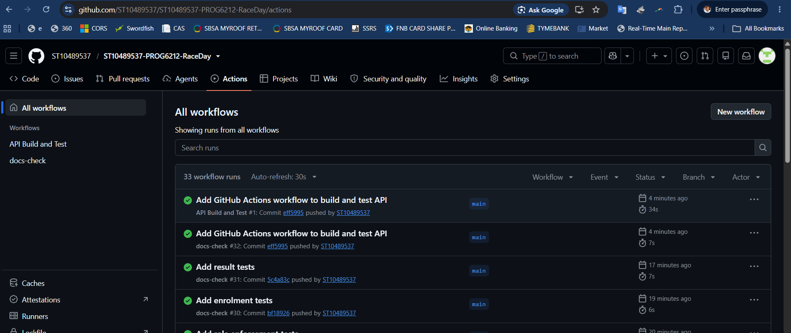

# RaceDay — Part 1: System Planning and Database

**Module:** PROG6212/w — Programming 2B
**Student:** Nkosana Khumalo | ST10489537

## System Description
RaceDay is a full-stack event management platform for South African road running,
walking, and cycling events. It allows Event Organisers to create and manage events,
categories, and participant results, while Participants can browse events, enter them
under a chosen category, and track their personal results history.

This repository currently contains the Part 1 planning deliverables: the Entity
Relationship Diagram, the API endpoint plan, and the SQL database script.

## Roles
- **Organiser** — creates, edits, and deletes events; manages event categories;
  captures participant results; views all enrolments for their events.
- **Participant** — registers an account, browses events, enrols in an event under
  a chosen category, and views their own enrolments and results.

## Repository Structure
- `docs/ERD_RaceDay.png` — Entity Relationship Diagram
- `docs/API_Endpoint_Plan.md` — Full API endpoint plan
- `docs/RaceDay_Schema.sql` — SQL Server schema and seed data script
- `.github/workflows/docs-check.yml` — CI check confirming the above files exist

## CI

## Video Presentation
Watch the Part 1 walkthrough here: https://youtu.be/i1V5dF0jPGg

## AI Disclosure
AI assistance was used for planning support (endpoint table structure and workflow
setup guidance), reviewed and finalised by the me.

# RaceDay — Part 2: RESTful API

## Overview
ASP.NET Core Web API (.NET 10) using Entity Framework Core (Code-First) on SQL Server. Authentication uses server-side sessions, and access is controlled by role for two roles.

## Roles
- **Organiser:** creates, edits and deletes their own events; manages categories; views enrolments; captures and corrects results.
- **Participant:** browses events and categories, enrols in an event by choosing a category, views their own enrolments and results.

Anyone can register as a Participant. Registering as an Organiser requires a secret invite code (setting `OrganiserSettings:InviteCode` in `appsettings.json`).

## Setup and run
1. Install the .NET 10 SDK and SQL Server (or LocalDB).
2. Open `Part2/RaceDay.Part2/RaceDay.Part2.slnx` in Visual Studio.
3. In `RaceDay.Api/appsettings.json`, set `ConnectionStrings:DefaultConnection` to your SQL Server instance.
4. In the Package Manager Console (default project `RaceDay.Api`) run `Update-Database`.
5. Run `RaceDay.Api` using the http or https profile. Sample data is seeded on first run.
6. Open `/swagger` in your browser (for example `http://localhost:5298/swagger`).

## Test accounts (password for all: `Password123!`)
| Role | Email |
|---|---|
| Organiser | thandeka.mokoena@raceday.co.za |
| Organiser | sipho.naidoo@raceday.co.za |
| Participant | lindiwe.dlamini@example.com |
| Participant | johan.vdm@example.com |

Organiser invite code for new registrations: `[your code from appsettings.json]`

## Unit tests
`dotnet test Part2/RaceDay.Part2/RaceDay.Part2.slnx` — uses an in-memory database, so SQL Server is not needed.

## CI/CD

## Differences from the Part 1 plan
All endpoints in the Part 1 plan are implemented with the same routes and roles. Additions and clarifications:
- `POST /api/auth/register` also accepts `phoneNumber` and `organiserCode`; Organiser registration requires the invite code (403 if missing or wrong).
- Added `GET /api/events/mine` (an Organiser's own events, including past ones, for the dashboard).
- Added `GET /api/events/{eventId}/results` (an Organiser views captured results for their event).
- `GET /api/events` has an optional `upcoming` parameter (default true) next to the `type` filter.
- The ERD shows keys and core attributes; the SQL script and the EF Core model contain the full column list.
- Extra validation and error responses (400, 401, 403, 404, 409) are returned beyond those listed in the plan.

## Video
[Part 2 walkthrough] https://youtu.be/i1V5dF0jPGg

## AI usage disclosure
[Briefly state how you used AI tools, for example for planning the build order, explaining concepts and helping debug errors, and that you wrote and can explain the code.]